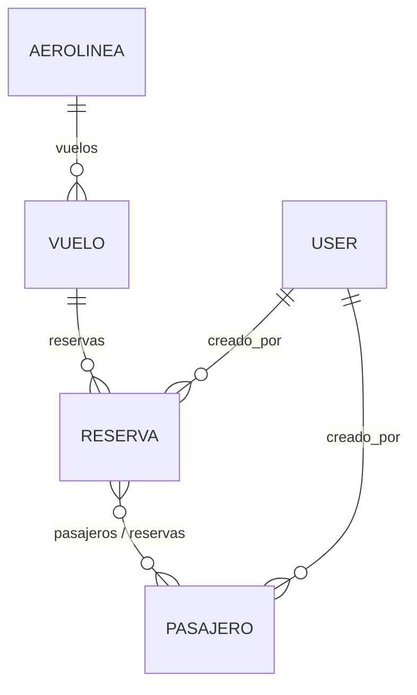

# vuelos-app

Aplicación web en Django para la **reserva de vuelos**.

- Autora: Nathaly Cuenca
- Tema asignado: reserva de vuelos
- Python 3.10 o superior, Django 5.2

## Modelo de datos

Cuatro tablas relacionadas:

| Modelo | Campos principales | Relaciones |
|---|---|---|
| `Aerolinea` | nombre, codigo_iata, pais, activa | Una aerolínea tiene muchos vuelos (`vuelos`) |
| `Vuelo` | codigo, origen, destino, fecha_salida, fecha_llegada, precio (Decimal), asientos, estado (TextChoices) | `ForeignKey` a `Aerolinea` (`PROTECT`, `related_name='vuelos'`) |
| `Pasajero` | nombres, apellidos, documento, email, fecha_nacimiento, nacionalidad | Un pasajero tiene muchas reservas (`reservas`); `ForeignKey` a `User` en `creado_por` (`SET_NULL`, `related_name='pasajeros_creados'`) |
| `Reserva` | codigo, clase y estado (TextChoices), fecha_reserva, total (Decimal) | `ForeignKey` a `Vuelo` (`PROTECT`, `related_name='reservas'`), `ManyToManyField` a `Pasajero` (`related_name='reservas'`), `ForeignKey` a `User` en `creado_por` (`SET_NULL`, `related_name='reservas_creadas'`) |



## Estructura

```
vuelos-app/
  config/
  vuelos/
    models/      aerolinea.py  vuelo.py  pasajero.py  reserva.py
    forms/       aerolinea_form.py  vuelo_form.py  pasajero_form.py  reserva_form.py  registro_form.py
    views/       aerolinea_views.py  vuelo_views.py  pasajero_views.py  reserva_views.py  auth_views.py  inicio_views.py
    urls/        aerolinea_urls.py  vuelo_urls.py  pasajero_urls.py  reserva_urls.py  auth_urls.py
    templates/vuelos/{aerolineas,vuelos,pasajeros,reservas,auth}/
    management/commands/cargar_datos.py
    grupos.py  permisos.py  admin.py  apps.py  tests.py
  manage.py
  requirements.txt
```

## Levantar el proyecto desde cero

```bash
git clone <URL-DEL-REPOSITORIO>
cd vuelos-app
python -m venv venv
venv\Scripts\activate
pip install -r requirements.txt
python manage.py migrate
python manage.py cargar_datos
python manage.py runserver
```

En Linux o macOS se activa con `source venv/bin/activate`.

Abrir http://127.0.0.1:8000/

## Datos de prueba

`python manage.py cargar_datos` es reproducible (se puede ejecutar varias veces) y deja:

- 6 aerolíneas, 8 vuelos, 7 pasajeros (cada uno registrado por un usuario) y 6 reservas
- Los grupos `administradores` y `consultores` con sus permisos (también se crean automáticamente al ejecutar `migrate`)
- Los usuarios de prueba de la tabla siguiente

| Usuario | Contraseña | Grupo |
|---|---|---|
| `admin` | `Admin12345*` | Superusuario (también entra a `/admin/`) |
| `administrador1` | `Admin12345*` | `administradores` |
| `consultor1` | `Consultor12345*` | `consultores` |
| `consultor2` | `Consultor12345*` | `consultores` |

Los usuarios que se registran desde la pantalla de registro entran al grupo `consultores`.

## Grupos y permisos

| Grupo | Puede | No puede |
|---|---|---|
| `administradores` | Crear, editar y eliminar en las cuatro entidades; ver todos los pasajeros; editar o eliminar cualquier reserva | - |
| `consultores` | Ver aerolíneas y vuelos; registrar sus propios pasajeros; crear reservas; ver, editar y eliminar **solo los pasajeros y las reservas que ellos crearon** | Crear, editar o eliminar aerolíneas y vuelos; ver o modificar pasajeros y reservas de otros |

Al registrarse, el usuario da sus datos personales y el sistema crea automáticamente su pasajero. Al reservar, ese pasajero ya aparece marcado y solo puede elegir entre los pasajeros que él mismo registró (por ejemplo, familiares). Un administrador ve todos. Las vistas están protegidas con `@login_required` y `@permission_required`, y la regla de propiedad se valida con el campo `creado_por` de `Pasajero` y de `Reserva`. Los botones se ocultan en las plantillas con `perms` y el filtro `puede_modificar`. Un pasajero de otro usuario responde 404.

## Comandos útiles

```bash
python manage.py check
python manage.py test
python manage.py createsuperuser
```